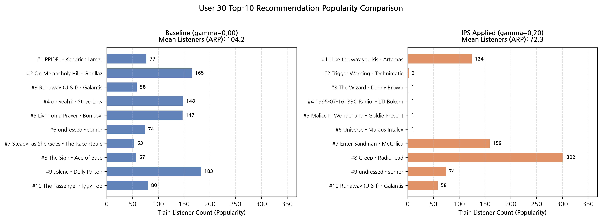
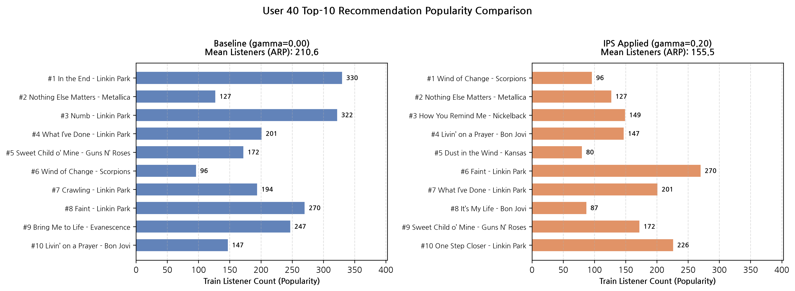
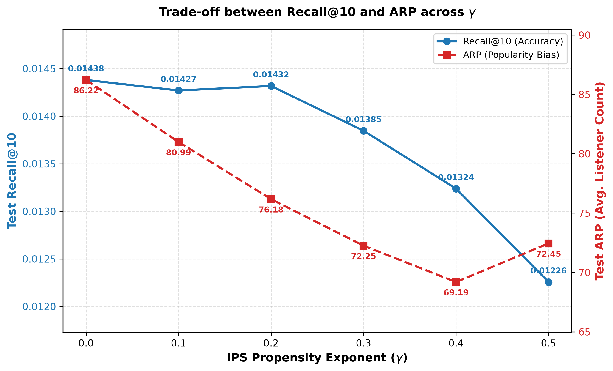
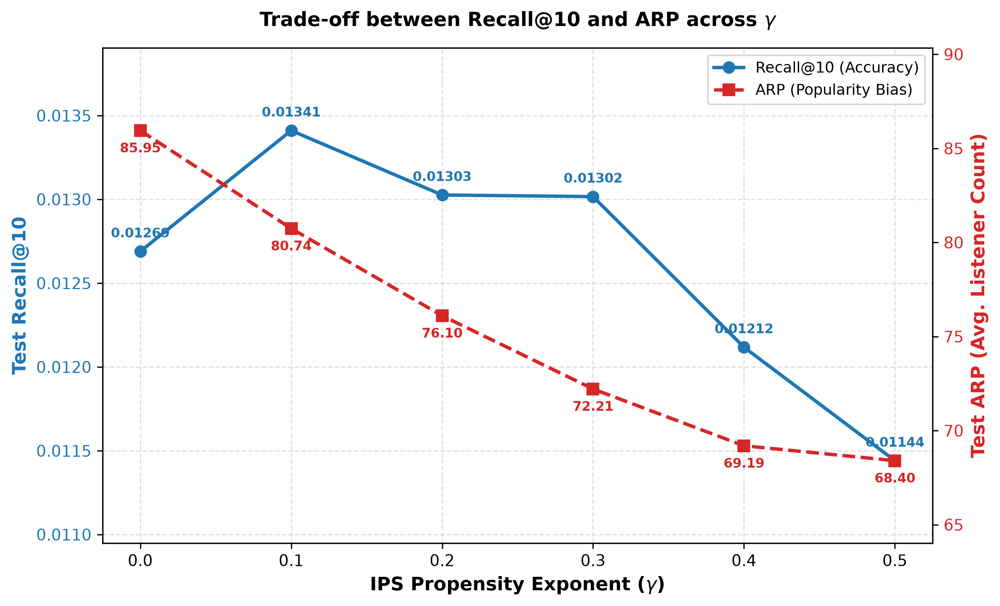

# ML-Team4-ImplicitMF

ListenBrainz 청취 로그(유저 5,000명, 곡 1,525,005개)를 기반으로, Collaborative Filtering의 **인기 편향(Popularity Bias)을 완화** 하고 롱테일(Long-tail) 곡 추천 성능을 높이는 Implicit-MF 기반 음악 추천 시스템.

> ~~모델 가중치 파일의 용량으로 인해, 이후에 추가한다.~~
> 


## Overview

* **모델 구조:** ALS(Alternating Least Squares) 기반 Implicit Matrix Factorization 
* **인기 편향 보정 (IPS):** 아이템별 청취자 수($P_i$)에 기반한 가중치($w_i \propto 1 / P_i^\gamma$)를 적용하여 인기곡 쏠림 현상을 제어하고 롱테일 아이템 노출을 확대

- [ML-Team4-ImplicitMF](#ml-team4-implicitmf)
  - [Overview](#overview)
  - [Setup](#setup)
  - [Run](#run)
    - [추천 결과](#추천-결과)
    - [학습](#학습)
    - [평가](#평가)
  - [성능 평가](#성능-평가)
    - [Baseline](#baseline)
    - [Find $\\gamma$](#find-gamma)
    - [Test set evaluation](#test-set-evaluation)
  - [File info](#file-info)


## Setup

```bash
# 가상환경 생성 및 활성화 (Linux / macOS)
python -m venv .venv
source .venv/bin/activate

# Windows
.\venv\Scripts\activate

# 패키지 설치
pip install -r requirements.txt
```

데이터셋은 마찬가지로 `./datasets/listenbrainz-preprocessing.zip` 를 동일 폴더 경로 `./datasets/` 로 압축을 풀어 준비한다.  

```bash
unzip datasets/listenbrainz-preprocessing.zip -d datasets
```

모델 파일은 이후 안내할 방법으로 실행 시 자동으로 `checkpoints/` 경로에 다운이 된다. (Baseline 모델과, $\gamma = 0.2$ 모델만 지원한다.)

만약 자동으로 다운이 되지 않는다면, 수동으로 Release 에서 `implicit_mf_gamma_{??}.npz` 를 다운 받아 사용할 수 있다. 

## Run

### 추천 결과 

저장된 `.npz` 모델 파일을 불러와 특정 유저의 학습 기간 청취 이력과 Top-K 추천 결과를 출력한다. 

```bash
python -m Scripts --user_idx user_idx --gamma gamma [--compare] --top_k top_k
```

| args | dtype | default | description |
| :---: | :---: | :---: | :---: | 
| `--user_idx` | `int`, `list[int]` | `0` | 추천을 생성할 유저 인덱스. 공백으로 구분하여 다수를 지정 |
| `--gamma` | `float` | `0.2` | IPS 편향 보정 강도 ($\in \{0.0, 0.1, 0.2, 0.3, 0.4, 0.5\}$) |
| `--compare`| `flag` | `False` | Baseline($\gamma = 0.0$) 과 `--gamma` 모델의 추천 결과 동시 비교 |
| `--top_k` | `int` | 10 | 유저당 추천할 곡 수 | 

<details>
<summary>사용예시</summary>

```bash
# 기본 실행: 최적 모델(gamma=0.2)로 0번 유저에게 Top-10 추천
python -m Scripts --user_idx 0 --gamma 0.2 --top_k 10

# 비교 실행: Baseline(gamma=0.0)과 IPS 적용 모델(gamma=0.2) 추천 결과 비교
python -m Scripts --user_idx 0 10 25 --gamma 0.2 --compare --top_k 10
```
</details>

실행 후, 각각 다음 결과물을 생성한다. 
- `results/recommendations.csv`: 추천 순위, 곡 ID, 곡명, 아티스트, 학습 청취자 수 원본 데이터
- `results/user_{user_idx}_rec_comparison.png`: Baseline 대비 IPS 모델의 추천 곡 인기도 분포 비교 차트
- `results/recommendations.md`: 유저별 학습 청취 이력(Top-5) 및 모델별 추천 곡 비교 마크다운 문서

<details>
<summary>결과물 예시</summary>




``` csv
user_idx,gamma,rank,item_idx,title,artist,train_listener_count
30,0.0,1,649225,PRIDE.,Kendrick Lamar,77
30,0.0,2,480118,On Melancholy Hill,Gorillaz,165
30,0.0,3,455295,Runaway (U & I),Galantis,58
30,0.0,4,1136098,oh yeah?,Steve Lacy,148
30,0.0,5,174680,Livin’ on a Prayer,Bon Jovi,147
30,0.0,6,1440996,undressed,sombr,74
30,0.0,7,1229265,"Steady, as She Goes",The Raconteurs,53
30,0.0,8,34133,The Sign,Ace of Base,57
```

[-> 생성된 .md 파일](./results/recommendations.md)

</details>

### 학습  

자체적으로 각 목적에 맞게 다음을 수행하여 학습을 진행할 수 있다. 

```bash
# 단일 모델 학습
python Scripts/train.py --mode single --k_dim [k_dim] --alpha [alpha] --gamma [gamma] --reg_weight [reg_weight]

# 전체 Grid Search 실행
python Scripts/train.py --mode grid

# 최적 모델 기준 Gamma 비교 실행
python Scripts/train.py --mode gamma
```

- 단일 모델 학습: 설정된 하이퍼파라미터로 학습을 진행
- 전체 Grid Search: $\gamma = 0$ 편향 무보정에서의 최적의 baseline 탐색
- Gamma 비교 실행: 주어진 baseline 의 하이퍼파라미터를 고정한 채, $\gamma \in [0.0, 0.5]$ 에 따라 학습을 진행

### 평가 

학습된 모델에 대하여, 다음을 통해 Recall@10, ARP 를 평가할 수 있다. 

- Baseline vs 최종 선정 모델($\gamma = 0.2$) 1:1 평가

```bash
python Scripts/test.py --mode compare
```

- 특정 $\gamma$ 체크포인트 파일 평가

``` bash
python Scripts/test.py --mode single --gamma 0.2

# 또는 경로 직접 지정
python Scripts/test.py --mode single --weight_path checkpoints/implicit_mf_gamma_0.2.npz
```

- 전체 $\gamma \in [0.0, 0.5]$ 에 대해 평가 및 그래프/로그 저장

``` bash
python Scripts/test.py --mode sweep
```

## 성능 평가

### Baseline 

먼저 IPS 미적용 ($\gamma = 0$) 에 대해서, Baseline 이 되는 모델을 찾는다. 이는 동일한 학습데이터 `train_interactions.csv` 에서 진행하며, `validation_targets.csv`, `validation_users.csv` 에 기반하여 `Recall@10` 을 기준으로 최적의 Baseline 모델을 찾는다.  

자세한 과정은 -> [Link](./docs/baseline_model.md)

### Find $\gamma$

앞서 도출한 Baseline 모델로부터, $\gamma \in \{0.0, 0.1, 0.2, 0.3, 0.4, 0.5\}$ 에 따라 각 성능을 비교한다. 마찬가지로 이는 `validation_targets.csv`, `validation_users.csv` 에 기반하여 `Recall@10` 을 기준으로 한다.

| $\gamma$ | R@10 | ARP | R@50 | R100 | 
| :---: | :---: | :---: | :---: | :---: | 
| 0.0 | 0.01438 | 86.22088 | 0.04445 | 0.06801 | 
| 0.1 | 0.01427 | 80.99437 | 0.04386 | 0.06856 | 
| 0.2 | 0.01432 | 76.18116 | 0.04320 | 0.06693 | 
| 0.3 | 0.01385 | 72.25331 | 0.04185 | 0.06535 | 
| 0.4 | 0.01324 | 69.19154 | 0.04161 | 0.06402 | 
| 0.5 | 0.01225 | 72.44931 | 0.03853 | 0.06090 | 

(소수점 6번째 자리에서 반올림하여 나타낸다.)

각 학습 후의 $\gamma$ 에 따른 모델 가중치는 다음에 저장된다. 

- `./checkpoints/implicit_mf_gamma_??.npz`

(?? 는 $\gamma$ 값을 나타낸다.)

<details>
<summary>세부 지표 (원본)</summary>

```csv
k_dim,alpha,gamma,reg_weight,iteration,random_state,top_k,best_epoch,best_val_recall@10,best_val_recall@50,best_val_recall@100,best_val_arp
256,20.0,0.0,0.05,20,777,10,20,0.01438155506005899,0.04444773521776413,0.06800637177977403,86.22088220295768
256,20.0,0.1,0.05,20,777,10,20,0.014270094359952853,0.04386056307663671,0.06856340047097632,80.99436511983683
256,20.0,0.2,0.05,20,777,10,20,0.014317826325364543,0.04319724882271689,0.06693407547422253,76.181157572667
256,20.0,0.3,0.05,20,777,10,20,0.01384708081487532,0.041852503033984266,0.06535268022538047,72.25331463539011
256,20.0,0.4,0.05,20,777,10,20,0.013238765042888182,0.04161362371019395,0.06401691194145832,69.19153493115758
256,20.0,0.5,0.05,20,777,10,15,0.01225692458757646,0.03853097636339763,0.06090012741862648,72.44931157572667
```

</details>



위와 같이, $\gamma \in [0.0, 0.4]$ 구간에서 $\gamma$ 가 커질수록 `ARP`가 일관되게 감소하며, $\gamma = 0.5$ 부턴, 강한 편향 보정으로 인해 `Recall@10` 과 `ARP` 가 동시에 약화되는 것을 볼 수 있다.  
이에 위 실험 결과에 근거하여, `Recall`-`ARP` trade-off 최적점 또는 편향 보정에 집중한 `ARP` 최적점 두가지 관점에서 $\gamma$ 를 선택할 수 있다. 

| $\gamma$ | Recall@10 | 무작위 추천 대비 성능 | ARP | $\Delta$Recall@10 (%) | $\Delta$ ARP (%)|
| :---: | :---: | :---: | :---: | :---: | :---: |
| 0.2 | **0.01432**  | 약 2,184배 | 76.18  | -0.42% | -11.64% |
| 0.4| 0.01324 | 약 2,019배 | **69.19**  | -7.93% | -19.75% |

<details>
<summary>무작위 추천 성능</summary>

이때, 무작위 추천의 `Recall@K` 기댓값은 다음을 통해 계산한다.  

$$
\mathbb{E}[\text{Recall@}K_{\text{random}}] = \frac{K}{\text{아이템 수}} = \frac{K}{1,525,005}
$$

</details>

이후 실제 테스트 데이터셋을 통한 평가에서는 $\gamma = 0.2$ 를 선정하여 진행한다.  

### Test set evaluation

학습된 모델에 대한 실제 성능 평가는 `test_targets.csv`, `test_users.csv` 를 기반으로 진행한다.  

| $\gamma$ | Recall@10 | ARP | $\Delta$Recall@10 (%)| $\Delta$ARP (%) |
| :---: | :---: | :---: | :---: | :---: |
| 0.0 (baseline) | 0.01269 | 85.94621 | - | - |
| 0.2 | 0.01303 | 76.10418 | +2.65% | -11.45% |

Validation 데이터셋을 통해 선정한 $\gamma = 0.2$ 모델을 테스트 데이터셋에 적용한 결과, Baseline($\gamma = 0.0$) 대비 추천 곡의 평균 청취자 수 `ARP` 가 $-11.45$% 감소하였다.  
일반적으로 앞서 validation 데이터셋의 경우에서 보았듯이, `ARP` 가 감소함에 따라 `Recall@10` 도 하락을 동반하지만, 실제 테스트 평가에서는 `Recall@10` 이 $+2.65$% 로 함께 상승하여, 정확도 손실 없이 인기 편향을 효과적로 보정했음을 알 수 있다.  

무작위 추천의 경우, `Recall@10` 의 기댓값은 $10 / 1,525,005 \approx 6.56 \times 10^{-6}$ 이며, IPS 적용 모델은 `Recall@10` 이 $0.01303$ 을 달성하여, 무작위 추천 대비 약 1,976배 높은 성능을 기록하였다.  

추가적으로, Validation 경우와 마찬가지로, $\gamma \in \{0.0, 0.1, 0.2, 0.3, 0.4, 0.5\}$ 에 따라 테스트 데이터셋에서의 평가를 진행하였다.  



Validation 기준으로 선정한 최종 모델 ($\gamma = 0.2$) 의 Test 평가 결과, Baseline ($\gamma = 0$) 대비 `Recall@10` 은 $+2.68$% ($0.01269 \rightarrow$ 0.01303) 향상되었고, `ARP`는 $-11.46$% ($85.95 \rightarrow 76.10$) 으로 감소하여, 정확도와 편향 완화 모두 개선되는 것을 확인하였다.  

추가적으로 Test 데이터에 대해, $\gamma = 0.2 \rightarrow 0.3$ 구간에서도 `Recall@10` 수치가 거의 유지되면서, Baseline 대비 `ARP` 가 $-15.99$% ($72.21$) 까지 추가적으로 완화되는 것을 관찰하였다. 이는 미관측 일반화 환경에서는 편향 보정의 유효범위가, $\gamma = 0.3$ 수준까지 확장될 수 있음을 나타낸다.  

## File info

- `./logs`

| file | description |
| :---: | :---: |
| `grid_search_results.csv` | $\gamma = 0.0$ 고정 하에, Validation 데이터셋에서의 하이퍼 파라미터 조합 별 학습 성능 로그 |
| `gamma_search_results.csv` | `grid_search_results.csv` 에서 산출한 최적의 하이퍼 파라미터 조합에 대해, $\gamma$ 별 학습 성능 로그 |
| `test_gamma_results.csv` | 학습된 모델에 대해 Test 데이터셋에 대한 성능 로그 |

- `./Scripts`

| file | description |
| :---: | :---: |
| `load_datasets.py` | `Train`, `Validation`, `Test` 데이터셋을 불러와 반환 |
| `implicit_mf.py` | Implicit-MF 모델 클래스 구현. 추천 및 성능 평가 method 포함 | 
| `train.py` | 주어진 모델 구조에 대해, 하이퍼파라미터 조합 별 학습 후 `Validation` 데이터셋에서의 성능 지표 기록 및 `.csv` 저장 | 
| `test.py` | 학습된 모델에 대해 `Test` 데이터셋에서의 성능 지표 기록 및 `.csv`, `.png`, `.md` 결과 저장 |

- `./utils`

| file | description |
| :---: | :---: |
| `utils.py` | 유용 함수 정의 | 

- `./`

| file | description |
| :---: | :---: |
| `configs.py` | 전역 변수 설정 | 